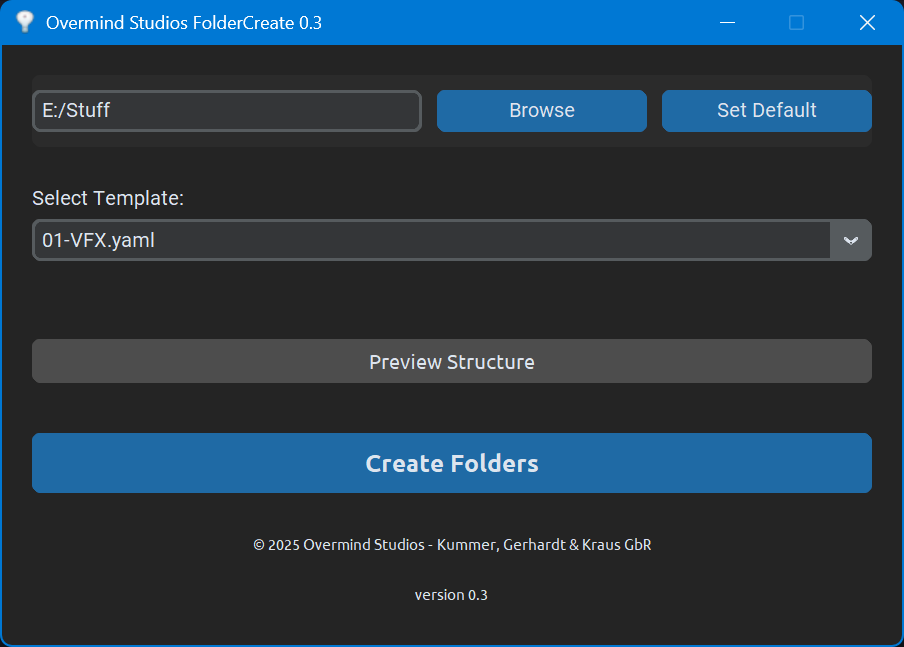

# FolderCreate 📁✨

<p align="center">
  
</p>

<p align="center">
  <strong>منصة متقدمة لإدارة مساحة العمل، وهيكلة المجلدات عبر قوالب YAML، ومتابعة مشاريع العملاء واعتماد التصاميم</strong>
  <br />
  <em>Executive-Grade Designer Workspace & Automated Project Structuring Suite</em>
</p>

<p align="center">
  
  
  
  
</p>

---

## 🌟 نظرة عامة | Overview

**FolderCreate** هو تطبيق سطح مكتب متكامل مصمم خصيصاً للمصممين، المونتيرين، وشركات الإنتاج الإبداعي (VFX, 3D, Design, Video Editing).  
يوفر التطبيق بيئة عمل احترافية تدعم اللغة العربية (RTL) بشكل أصيل لإدارة ملفات العملاء، توليد هياكل المشاريع المعقدة بضغطة زر واحدة عبر قوالب YAML، متابعة دورة حياة التصاميم (Review Pipeline)، وتحرير مساحة التخزين من الملفات المؤقتة.



---

## 🚀 المميزات الرئيسية | Key Features

### 🏠 1. لوحة التحكم التنفيذية (Executive Dashboard)
- ملخص رقمي شامل لعدد العملاء، المشاريع المنجزة، والتصاميم قيد المراجعة.
- أزرار وصول سريع إلى كافة وحدات النظام الأكثر استخداماً.

### 👥 2. مركز إدارة العملاء (Clients Hub)
- إنشاء وإدارة سجلات العملاء وربطها بالمجلدات الجذرية على الأقراص المحلية أو المشتركة.
- تنظيم وهيكلة شهور وسنوات العمل تلقائياً مع دعم إضافة شعارات وأكواد مخصصة للعملاء.

### 📋 3. لوحة اعتماد ومراجعة التصاميم (Design Review Pipeline)
- نظام Kanban متطور لمتابعة حالة التصاميم:
  - 📝 **مسودة (Draft)**
  - ⏳ **قيد العمل (In Progress)**
  - 👀 **للمراجعة (Pending Review)**
  - ✅ **معتمد (Approved)**
- إمكانية سحب وإفلات الملفات والصور مباشرة من متصفح ويندوز (Drag & Drop).
- معاينة مرئية للصور وإضافة وسوم مخصصة لكل عنصر.

### 🧹 4. منظف الملفات المؤقتة (Smart Temp Cleaner)
- كشف وتفريغ ملفات الكاش والملفات المؤقتة لبرامج التصميم الرائدة:
  - Adobe After Effects
  - Adobe Premiere Pro
  - Adobe Photoshop
  - Blender
  - Windows Temp & Prefetch
- تحرير مساحات التخزين بسرعة وأمان دون التأثير على ملفات العمل الأصلية.

### 📁 5. محرك القوالب وهيكلة المجلدات (Template Generator)
- إنشاء مجلدات المشاريع بالكامل في ثوانٍ بناءً على قوالب YAML مهيكلة مسبقاً (VFX, Vector, Score, إلخ).
- إمكانية إضافة وتعديل قوالب YAML جديدة بكل مرونة لتناسب متطلبات أي مشروع.

### ⭐ 6. المفضلة والوصول السريع (Favorites & Recents)
- تثبيت المجلدات الحيوية الأكثر زيارة.
- سجل تلقائي بأحدث المسارات والمجلدات التي تم التعامل معها للوصول الفوري إليها.

### 🎨 7. واجهة مستخدم احترافية (Executive Dark/Light UI)
- واجهة مبنية بتقنية `CustomTkinter` الحديثة بدعم كامل للمظهر الداكن والفاتح.
- دعم الاتجاه من اليمين لليسار (RTL) مع خط `Rubik` العربي المدمج عبر Windows GDI.
- إمكانية السحب والإفلات المباشر (TkinterDnD2).

---

## 📂 بنية المشروع | Project Structure

```text
FolderCreate/
├── assets/                  # الأصول الرسومية والخطوط
│   ├── fonts/Rubik.ttf      # خط Rubik المدمج بالنظام
│   └── graphics/appicon.ico # أيقونة التطبيق
├── core/                    # المنطق البرمجي الأساسي (Business Logic)
│   ├── client_manager.py    # إدارة العملاء
│   ├── dnd_helper.py        # مساعد السحب والإفلات
│   ├── font_loader.py       # تسجيل الخطوط عبر Windows GDI
│   ├── path_manager.py      # إدارة المسارات
│   ├── review_pipeline.py   # خط أنابيب اعتماد التصاميم
│   ├── temp_cleaner.py      # فاحص ومنظف الملفات المؤقتة
│   └── template_engine.py   # قارئ ومولد قوالب YAML
├── ui/                      # واجهات المستخدم (CustomTkinter Views)
│   ├── app_window.py        # النافذة الرئيسية والشريط الجانبي
│   ├── dashboard_view.py    # شاشة لوحة التحكم
│   ├── clients_view.py      # شاشة العملاء والمجلدات
│   ├── review_board_view.py # شاشة لوحة المراجعة (Kanban)
│   ├── temp_cleaner_view.py # شاشة منظف المؤقتات
│   ├── favorites_view.py    # شاشة المفضلة
│   ├── recents_view.py      # شاشة العناصر الأخيرة
│   ├── template_generator_view.py # شاشة توليد القوالب
│   └── *.dialog.py          # مربعات الحوار التفاعلية
├── data/                    # طبقة تخزين البيانات (Local Storage)
│   ├── app_store.py         # محرك حفظ البيانات الموحد (JSON Store)
│   └── client_store.py      # مخزن العملاء
├── templates/               # قوالب YAML الجاهزة لهياكل المشاريع
│   ├── 01-VFX.yaml
│   ├── 02-Vector.yaml
│   └── 03-Score.yaml
├── main.py                  # نقطة الدخول الرئيسية للبرنامج
├── FolderCreate.py          # الإصدار الكلاسيكي المستقل (v0.3)
├── auto-py-to-exe.json      # ملف تكوين التحويل إلى ملف تنفيذي (.exe)
├── تشغيل_البرنامج.bat       # مشغل سريع للويندوز
├── requirements.txt         # التبعات البرمجية
└── README.md                # دليل التوثيق
```

---

## 🛠️ التثبيت والتشغيل | Installation & Setup

### 1. المتطلبات الأساسية
- نظام تشغيل **Windows 10 / 11**
- **Python 3.10+** (يفضل 3.11 أو 3.12)

### 2. تثبيت الحزم المطلوبة
```bash
# استنساخ المشروع
git clone https://github.com/khalilkorichi/FolderCreate.git
cd FolderCreate

# تثبيت التبعات
pip install -r requirements.txt
```

### 3. تشغيل البرنامج
يمكن تشغيل البرنامج عبر الأمر التالي:
```bash
python main.py
```
أو ببساطة عبر النقر المزدوج على ملف:
```text
تشغيل_البرنامج.bat
```

---

## 📦 بناء ملف تنفيذي | Build Standalone EXE

يمكن تحويل المشروع إلى ملف تنفيذي مستقل (`.exe`) دون الحاجة لتثبيت بايثون لدى المستخدم النهائي:

1. قم بتثبيت `auto-py-to-exe` أو `pyinstaller`:
   ```bash
   pip install auto-py-to-exe pyinstaller
   ```
2. شغّل أداة التحويل مع ملف الإعدادات المرفق:
   ```bash
   auto-py-to-exe -c auto-py-to-exe.json
   ```

---

## 📄 نموذج قالب YAML | YAML Template Example

تنسيق بسيط وقوي لإنشاء هياكل شجرية كاملة:

```yaml
- 00-BRIEFING
- 01-FROM_CLIENT
- 10-OWN_FOOTAGE:
  - 00-RENDER
  - 10-IMAGES
- 50-WORKSPACE:
  - 00-DEFAULT:
    - 10-BLENDER
    - 20-FUSION
- 99-DELIVERIES
```

---

## 📝 الترخيص | License

هذا المشروع مرخص بموجب رخصة [MIT License](LICENSE).

---

<p align="center">
  طُوّر بواسطة <strong>خليل قريشي</strong> • Overmind Studios
</p>
